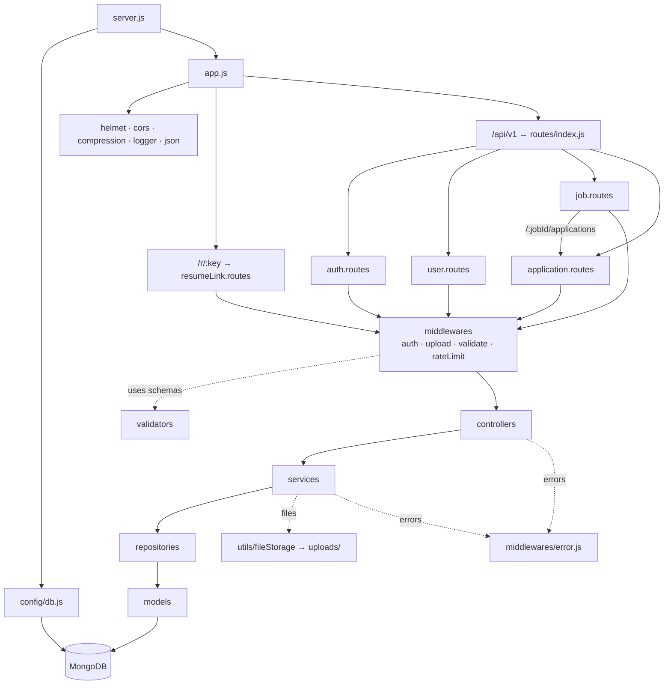

# Project Flow

How the folders under `src/` connect, from process start-up to the database. Read it top to bottom: section 1 is what runs when the server boots, section 2 is what happens to a single request, section 3 explains each folder.

---

## 1. Start-up: `server.js` → `app.js`

```
 npm run dev / npm start
          │
          ▼
 ┌─────────────────────────┐
 │ src/server.js           │  process entry point
 │  • starts the server    │  graceful shutdown (SIGINT / SIGTERM)
 │  • handles crashes      │
 └───────┬─────────┬───────┘
         │         │
         │         └──────────────────────────────┐
         ▼                                        ▼
 ┌─────────────────────────┐          ┌───────────────────────────┐
 │ src/config/db.js        │          │ src/app.js                │
 │ connectDB()             │          │ builds the Express app    │
 └───────┬─────────────────┘          └─────────────┬─────────────┘
         │                                          │ uses
         ▼                                          ▼
 ┌─────────────────────────┐          ┌───────────────────────────┐
 │ MongoDB                 │          │ config/  middlewares/     │
 └─────────────────────────┘          │ routes/  utils/fileStorage│
                                      └───────────────────────────┘

 Every file reads settings through  src/config/env.js  (validates .env with zod)
 and logs through                    src/config/logger.js  (pino)
```

---

## 2. A request, layer by layer

```
                         HTTP request
                              │
                              ▼
 ┌────────────────────────────────────────────────────────────────────┐
 │  src/app.js   global middleware, in this order                     │
 │                                                                    │
 │  /api-docs ── Swagger UI (config/swagger.js)  — mounted first      │
 │  helmet → cors → compression → pino-http logger → express.json     │
 │  /uploads/avatars ── static profile images / company logos         │
 │                                                                    │
 │  /r/<key> ────────► apiLimiter ► routes/resumeLink.routes.js       │
 │  /api/v1/* ───────► apiLimiter ► routes/index.js                   │
 └────────────────────────────────┬───────────────────────────────────┘
                                  ▼
 ┌────────────────────────────────────────────────────────────────────┐
 │  ROUTES   src/routes/            "which URL goes where"            │
 │  index.js  /health                                                 │
 │            /auth          (authLimiter) ► auth.routes.js           │
 │            /users                       ► user.routes.js           │
 │            /jobs                        ► job.routes.js            │
 │            /jobs/:jobId/applications   ► application.routes.js     │
 │            /applications                ► application.routes.js    │
 │  Each route lists its middlewares, then the controller.            │
 └────────────────────────────────┬───────────────────────────────────┘
                                  │ passes through, in order:
                                  ▼
 ┌────────────────────────────────────────────────────────────────────┐
 │  MIDDLEWARES   src/middlewares/                                    │
 │  auth.js      authenticate (JWT) ► authorize(roles)                │
 │  upload.js    multer: resume (pdf/doc/docx) or avatar (jpg/png/webp)│
 │  validate.js  checks body / query / params with a zod schema ──────┼──► validators/
 │  rateLimit.js request limits                                       │
 └────────────────────────────────┬───────────────────────────────────┘
                                  ▼
 ┌────────────────────────────────────────────────────────────────────┐
 │  CONTROLLERS   src/controllers/      "HTTP in, HTTP out"           │
 │  read req.body / params / user / file, call ONE service,           │
 │  send the reply with utils/response.js                             │
 └────────────────────────────────┬───────────────────────────────────┘
                                  ▼
 ┌────────────────────────────────────────────────────────────────────┐
 │  SERVICES   src/services/            "business rules"              │
 │  ownership checks, role rules, JWT signing, building file keys,    │
 │  pagination. Never touches a model directly.                       │
 │  application.service ──► job.service  (is this my job?)            │
 │  user / application services ──► utils/fileStorage.js (disk files) │
 └────────────────────────────────┬───────────────────────────────────┘
                                  ▼
 ┌────────────────────────────────────────────────────────────────────┐
 │  REPOSITORIES   src/repositories/    "all database queries"        │
 │  user.repository · job.repository · application.repository         │
 └────────────────────────────────┬───────────────────────────────────┘
                                  ▼
 ┌────────────────────────────────────────────────────────────────────┐
 │  MODELS   src/models/                "shape of the data"           │
 │  user.model · job.model · application.model  (mongoose schemas)    │
 └────────────────────────────────┬───────────────────────────────────┘
                                  ▼
                       ┌─────────────────────┐
                       │  MongoDB            │
                       │  users · jobs ·     │
                       │  applications       │
                       └─────────────────────┘

 Any error thrown above (ApiError, validation, mongoose, multer) travels
 back up to  middlewares/error.js  which sends the JSON error reply.
 Unknown URLs end at  notFound  in the same file.
```

Dependencies only point **down**. A controller never calls a repository, and a repository never calls a service.

---

## 3. Same flow as a Mermaid diagram



---

## 4. What each folder is for

| Folder / file | Job | Talks to |
|---|---|---|
| `server.js` | Boots the app, connects the database, shuts down cleanly | `app.js`, `config/db.js` |
| `app.js` | Builds Express: global middleware, mounts routes, error handlers | `routes/`, `middlewares/`, `config/` |
| `config/` | `env` (validated settings), `db` (connection), `logger`, `swagger` (API docs setup) | used by everything |
| `constants/` | Fixed lists: roles, job types, statuses, education levels | models, validators, services |
| `routes/` | URL → middleware → controller wiring, plus the Swagger doc comments | `middlewares/`, `controllers/`, `validators/` |
| `middlewares/` | Reusable steps before a controller: auth, upload, validation, rate limit, errors | `repositories/` (auth only), `validators/` |
| `validators/` | zod schemas describing valid input for each endpoint | used by `validate.js` |
| `controllers/` | Translate request → service call → response | `services/`, `utils/` |
| `services/` | Business logic and rules | `repositories/`, other services, `utils/` |
| `repositories/` | The only code that runs database queries | `models/` |
| `models/` | Mongoose schemas, indexes, and how documents are shown in JSON | `config/env`, `constants/` |
| `utils/` | Small helpers: `ApiError`, `asyncHandler`, `pagination`, `response`, `fileStorage` | anywhere |

---

## 5. Worked example: apply to a job

`POST /api/v1/jobs/:jobId/applications` with a resume file

```
app.js ─► apiLimiter ─► routes/index.js ─► job.routes.js ─► application.routes.js
  ─► authenticate        (middlewares/auth.js: valid token? loads user via user.repository)
  ─► authorize(candidate)
  ─► uploadResume        (middlewares/upload.js: saves the file to uploads/resumes)
  ─► validate(apply)     (validators/application.validator.js: notice period, experience, skills)
  ─► application.controller.apply
  ─► application.service.apply   (job exists? job open? file present? builds the resume key)
  ─► job.repository.findById  /  application.repository.create
  ─► application.model  ─► MongoDB
  ◄─ 201 JSON with resume.candidate_resume_link  (…/r/<key>)
```

If validation or the service rejects the request, the uploaded file is deleted again (`utils/fileStorage.discardUpload`).

---

## 6. Where to add things

| I want to… | Touch |
|---|---|
| Add an endpoint | `routes/` → `controllers/` → `services/` → `repositories/` (and a schema in `validators/`) |
| Add a new resource | one new file in each of `routes`, `controllers`, `services`, `repositories`, `models`, `validators`, then mount it in `routes/index.js` |
| Change a database query | `repositories/` only |
| Change a business rule | `services/` only |
| Change allowed input | `validators/` only |
| Add a setting | `.env`, `.env.example`, `config/env.js` |

---

## 7. Admin account (development only)

Admins cannot register through the API (`role: "admin"` is rejected on `/auth/register`), so they are created directly in the database with the `create-admin` script ([`scripts/create-admin.js`](../scripts/create-admin.js)).

**Dev account** (created in the development database this project was set up with):

| | |
|---|---|
| Email | `admin@jobportal.local` |
| Password | `RLea_qSR7Zmr0dtW` |

> These credentials are for **local development only**. Never reuse them in staging or production, and change the password if the database is shared. The account only exists in the database it was created in, so on a fresh database create your own (below).

**Create an admin in your own database**

```bash
# random password, printed once
npm run create-admin -- someone@example.com "Their Name"

# or choose the password yourself (8–72 characters)
ADMIN_PASSWORD='your-own-password' npm run create-admin -- someone@example.com
```

If the email already exists the script changes nothing. Run it from `backend/` with `MONGO_URI` set in `.env`.

**What an admin can do**

| Area | Access |
|---|---|
| Users | list, view and delete any user (`/users`, `/admin/users` in the frontend) |
| Jobs | edit or delete any job, not only their own |
| Applications | view applications for any job and change their status |
