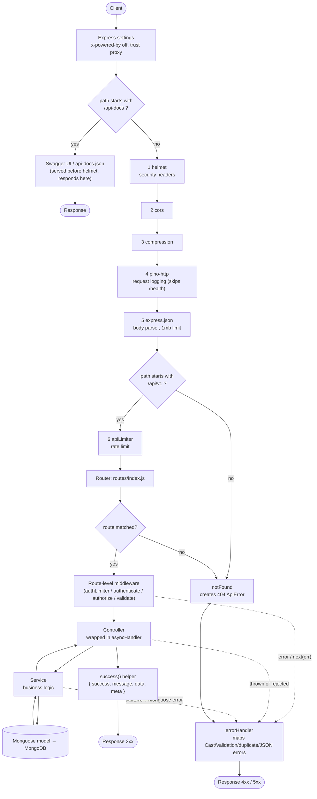
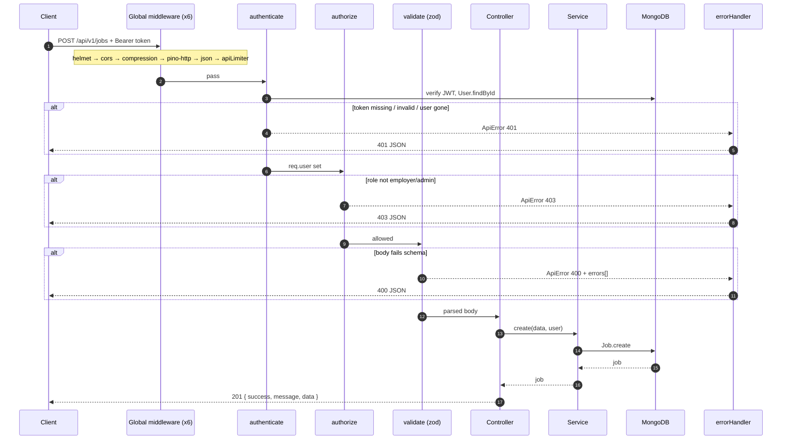

# Request → Response Flow

How a request travels through the Job Portal backend, and how many middleware and handlers each endpoint passes through.
Source of truth: [`src/app.js`](../src/app.js), [`src/routes/index.js`](../src/routes/index.js) and each `*.routes.js`.

## 1. High-level pipeline



## 2. Sequence: a protected request (`POST /api/v1/jobs`)



## 3. Middleware count per endpoint

Every `/api/v1/*` request first passes through **6 global middleware**:
`helmet → cors → compression → pino-http → express.json → apiLimiter`.

"Route-level" is what each route adds on top, before the handler runs.

| Method & path | Route-level middleware (in order) | Total middleware | Then |
|---|---|---:|---|
| GET `/health` | – | 6 | inline handler |
| POST `/auth/register` | authLimiter → validate | 8 | controller → service |
| POST `/auth/login` | authLimiter → validate | 8 | controller → service |
| GET `/users/me` | authenticate | 7 | controller |
| PATCH `/users/me` | authenticate → validate | 8 | controller → service |
| GET `/users` | authenticate → authorize(admin) → validate | 9 | controller → service |
| GET `/users/:id` | authenticate → authorize(admin) → validate | 9 | controller → service |
| DELETE `/users/:id` | authenticate → authorize(admin) → validate | 9 | controller → service |
| GET `/jobs` | validate | 7 | controller → service |
| GET `/jobs/:id` | validate | 7 | controller → service |
| POST `/jobs` | authenticate → authorize(employer, admin) → validate | 9 | controller → service |
| PATCH `/jobs/:id` | authenticate → authorize(employer, admin) → validate | 9 | controller → service |
| DELETE `/jobs/:id` | authenticate → authorize(employer, admin) → validate | 9 | controller → service |
| POST `/jobs/:jobId/applications` | authenticate → authorize(candidate) → validate | 9 | controller → service |
| GET `/jobs/:jobId/applications` | authenticate → authorize(employer, admin) → validate | 9 | controller → service |
| GET `/applications/me` | authenticate → authorize(candidate) | 8 | controller → service |
| PATCH `/applications/:id/status` | authenticate → authorize(employer, admin) → validate | 9 | controller → service |
| DELETE `/applications/:id` | authenticate → authorize(candidate, admin) → validate | 9 | controller → service |

Non-API paths:

| Path | What runs |
|---|---|
| `/api-docs`, `/api-docs.json` | Swagger handlers only (mounted before helmet, so 0 global middleware) |
| anything else | helmet → cors → compression → pino-http → json → `notFound` → `errorHandler` |

## 3.1 Global middleware reference

These run, in this order, for every `/api/v1/*` request (configured in [`src/app.js`](../src/app.js)).

| # | Middleware | Purpose | What it does in this project |
|--:|---|---|---|
| 1 | **helmet** | Harden the app against common web attacks by setting secure HTTP response headers. | Adds headers such as `Content-Security-Policy`, `X-Content-Type-Options: nosniff`, `X-Frame-Options`, `Strict-Transport-Security` and `Referrer-Policy`. Reduces the risk of XSS, clickjacking and MIME sniffing. Swagger UI is mounted *before* it because Swagger needs inline scripts that helmet's CSP would block. |
| 2 | **cors** | Control which browser origins may call the API. | Reads `CORS_ORIGIN` from `.env` (`*` allows any origin; otherwise a comma-separated allow-list). Answers `OPTIONS` preflight requests and sets `Access-Control-Allow-*` headers. `credentials: true` allows cookies/auth headers from allowed origins. |
| 3 | **compression** | Reduce response size and bandwidth. | Gzip/deflate-compresses response bodies when the client sends `Accept-Encoding`. Mainly helps large JSON lists such as job searches. |
| 4 | **pino-http** | Structured request/response logging. | Logs method, URL, status code and response time as JSON through the shared pino logger, and attaches `req.log` (used by the error handler). Skips `/health` to avoid log noise. `Authorization` and `Cookie` headers are redacted. |
| 5 | **express.json** | Parse JSON request bodies. | Converts a `application/json` body into `req.body`. Limited to `1mb` to prevent oversized payloads. Malformed JSON raises an error that `errorHandler` turns into a 400. |
| 6 | **apiLimiter** | Protect against abuse, brute force and traffic spikes. | `express-rate-limit`: allows `RATE_LIMIT_MAX` requests (default 100) per IP per 15 minutes, then returns `429 Too many requests`. Sends `RateLimit-*` headers. Mounted only on `/api/v1`. Login/register have an extra, stricter `authLimiter` (20 per 15 min). |

## 4. Inventory

**Global middleware (6):** helmet, cors, compression, pino-http, express.json, apiLimiter
**Route-level middleware (4 kinds):** authLimiter, authenticate, authorize(...roles), validate(schema)
**Terminal handlers (2):** `notFound` (404 generator), `errorHandler` (single place that formats every error)
**Controllers (5 files, 17 actions):** auth (2), user (5), job (5), application (5, incl. list-for-job)
**Utilities in the path:** `asyncHandler` (forwards async errors to `next`), `success()` (response envelope), `ApiError` (typed errors)

## 5. Response shapes

```jsonc
// success
{ "success": true, "message": "OK", "data": { }, "meta": { "page": 1, "limit": 10, "total": 42, "totalPages": 5 } }

// error
{ "success": false, "message": "Validation failed", "errors": [ { "in": "body", "field": "email", "message": "Invalid email" } ] }
```

| Status | Raised by |
|---|---|
| 400 | `validate`, Mongoose Cast/Validation errors, malformed JSON |
| 401 | `authenticate`, bad login |
| 403 | `authorize`, ownership checks in services |
| 404 | `notFound`, services when a document is missing |
| 409 | duplicate email / duplicate application (Mongo `11000`) |
| 429 | `apiLimiter` / `authLimiter` |
| 500 | anything unexpected (stack hidden in production) |
